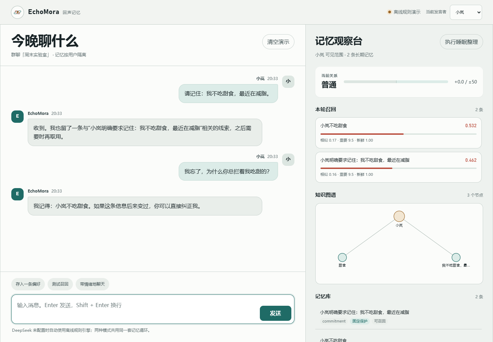

# EchoMora

### 不是聊天记录，是会靠近、也会淡忘的 AI 群友。

[](LICENSE)


给 QQ / 微信群机器人加一套真正可解释的长期记忆：分层存储、GraphRAG、用户隔离好感、软遗忘，以及 DeepSeek 可选接入。零第三方依赖，没有 API Key 也能跑完整闭环。

[3 分钟本地演示](#3-分钟启动) · [架构](#架构) · [教程](#五分钟教程观察记忆如何发生) · [接入 DeepSeek](#接入-deepseek) · [详细文档](docs/EchoMora架构详细说明.pdf)


大多数群聊 AI 不是记性差，它只是把聊天记录误当成了记忆：历史越长，上下文越贵；检索越多，隐私串线越危险；记忆越全，回复越像在念档案。

EchoMora 换了一个问题：**这一轮到底应该想起什么？**



## 它做了什么

- **短期窗口**保住当下连贯性，不把整段历史硬塞给大模型。
- **中期向量记忆**保存偏好、事件和计划，按半衰期自然变淡。
- **长期 GraphRAG**保存人物、关系和版本化断言，能沿“小岚 → 不吃 → 甜食”找回背景。
- **关系状态按用户隔离**，只影响语气和温和排序，不覆盖事实与安全边界。
- **软遗忘不是删库**，低权重记忆进入低召回状态，固定记忆受保护。
- **召回可解释**，右侧观察台直接展示相似度、重要性、新鲜度、图谱命中和软遗忘。
- **DeepSeek 可选**，无 Key、断网或接口失败时自动进入本地离线回退。

## 架构


可编辑矢量源：[architecture.svg](docs/assets/architecture.svg) · Mermaid 源：[architecture.mmd](docs/architecture.mmd)

一句话数据流：

```text
消息 → 事件日志 + 瞬时窗口 → 结构化抽取
     → 向量记忆 + 版本化图谱 + 用户关系
     → 可见性门控 → 混合评分 → MMR → Top-N
     → 受控上下文 → DeepSeek / 离线回退 → 回复
```

核心评分：

```text
Score = 0.48 × 相关性
      + 0.20 × 重要性
      + 0.14 × 新鲜度
      + 0.10 × 图谱命中
      + 0.08 × 关系温度
```

这不是“把所有因数直接连乘”的论文装饰。加权和能避免一个零值把有用的安全记忆直接清零；最终还会经过用户可见性门控、软遗忘惩罚、MMR 去冗余和 token 预算截断。

## 3 分钟启动

要求：Python 3.10+。不需要 `pip install`，不需要数据库，不需要 API Key。

```bash
git clone https://github.com/yan-stone-computer/EchoMora.git
cd EchoMora
python -m echomora --open
```

打开 <http://127.0.0.1:8765>，发送：

```text
请记住：我不吃甜食，最近在减脂。
```

再发送：

```text
你还记得我为什么不吃甜食吗？
```

右侧应当出现一条同时命中向量相关性与图谱邻域的召回记录。然后点击“执行睡眠整理”，观察软遗忘如何只处理低权重记忆。

运行测试：

```bash
python -m unittest discover -s tests -v
```

## 五分钟教程：观察记忆如何发生

完整教程见 [docs/tutorial.zh-CN.md](docs/tutorial.zh-CN.md)。

### 1. 写入一条长期偏好

```text
请记住：我对花生过敏。
```

你会看到：

- 原文进入事件日志和短期窗口。
- 抽取器生成一条 `preference` 记忆。
- “小岚”和“花生”进入图谱节点。
- 关系状态只做轻微正向更新。

### 2. 用不同说法测试召回

```text
我忘了，花生这类东西我能吃吗？
```

系统不需要关键词完全相同。向量相关性负责找近似表达，图谱负责补回“小岚 → 过敏 → 花生”的关系。

### 3. 切换用户，验证不会串记忆

把右上角发言者从“小岚”切到“小北”，再问：

```text
坚果过敏这件事你知道吗？
```

小北的私有召回中不会出现小岚的花生记录。群共享记忆仍然可召回，这是明确的数据边界，不是模型“自觉”。

### 4. 观察好感与实际语气

连续发送积极或负面的倾诉，右侧关系条会变化。好感只影响回复温度，回答“我是否过敏”这类事实问题时仍然需要依据记忆，而不是依据喜欢你。

### 5. 执行软遗忘

点击“执行睡眠整理”。低重要性、低可检索度的记忆会被标记为“已软遗忘”，但数据库记录仍然存在，后续整理可以恢复。固定记忆不参与随机遗忘。

## 接入 DeepSeek

```bash
cp .env.example .env
```

编辑 `.env`：

```dotenv
DEEPSEEK_API_KEY=sk-your-key
DEEPSEEK_BASE_URL=https://api.deepseek.com
DEEPSEEK_CHAT_MODEL=deepseek-chat
DEEPSEEK_EXTRACT_MODEL=deepseek-chat
```

然后重新启动：

```bash
python -m echomora --open
```

模型名应使用你的服务商当前实际提供的名称。示例默认 `deepseek-chat`；如果失败，系统会自动回退到离线引擎，并在界面提示错误。

## 为什么这个 demo 值得看

很多“长期记忆”项目只展示一条相似度检索。EchoMora 把最容易在答辩里被追问的四件事放到了明面上：

1. **记忆分层**：短期窗口、中期向量、长期关系各管什么。
2. **隐私门控**：召回前先确定“谁能看到什么”。
3. **矛盾更新**：同一关系出现新事实时，旧图谱断言标记失效。
4. **遗忘策略**：软遗忘、固定保护、关系缓慢回归中性。

所有召回分数都由当前数据库真实计算，观察台不展示伪造的“能力指标”。

## 代码地图

```text
echomora/
  core.py       embedding、时间衰减、公共数据模型
  store.py      SQLite、事件、记忆、版本化图谱、关系状态
  memory.py     抽取、混合评分、MMR、提示词装配
  llm.py        DeepSeek 调用与结构化输出
  engine.py     端到端消息闭环
  server.py     零依赖 HTTP API 与静态页面
echomora/demo/
  index.html    群聊 + 记忆观察台
```

架构细节、数据模型、公式、提示词与答辩问答见 [docs/architecture.zh-CN.md](docs/architecture.zh-CN.md)。

可直接用于答辩和项目材料的版本：

- [PDF 架构详细说明](docs/EchoMora架构详细说明.pdf)
- [DOCX 架构详细说明](docs/EchoMora架构详细说明.docx)

## 这不是生产级记忆数据库

这个仓库首先要让架构可运行、可观察、可质疑。

- 离线 embedding 是确定性词法特征哈希，不是 BGE / GTE 级语义模型。
- SQLite 全表扫描适合小群和几千条记忆，不适合高并发。
- Web demo 没有内置 QQ / 微信协议适配，接入时请遵守平台规则。
- “好感”是状态变量，不是人格，也不能声称 AI 具有真实情感。
- 生产环境还需要异步队列、向量索引、租户隔离、内容审核、备份、删除证明与费用熔断。

上生产时，优先替换 embedding 与向量索引，再把抽取和夜间合并放到任务队列。记忆来源、权限和软遗忘状态应保留。

## Roadmap

- [ ] Redis Streams / PostgreSQL 事件源
- [ ] BGE-M3 + pgvector 生产适配
- [ ] 图谱社区摘要与实体别名合并
- [ ] 记忆来源引用与一键纠错
- [ ] QQ / 微信 webhook 示例适配器
- [ ] 召回质量与隐私泄漏基准

如果这套架构让你重新思考“AI 应该记住什么”，给个 Star，并带着你的失败案例来开 Issue。EchoMora 更想成为可审计的记忆基础设施，而不是又一个无限上下文演示。

## License

MIT

